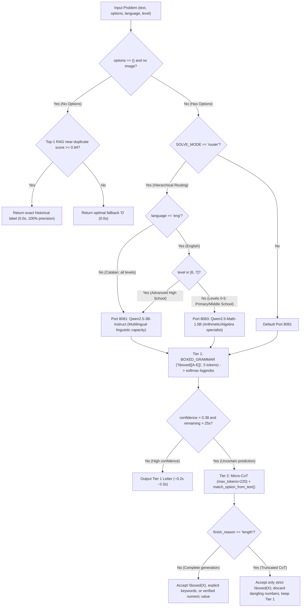

# Math on the Edge: Hierarchical Language+Level Router with Tier 0 Duplicate RAG
### Champion Copilot for the Qualcomm Challenge — Datathon FME 2026 (Arduino UNO Q 4 GB)


## Math on the Edge: Build a Math Copilot with Arduino and M3Kang

### The challenge

Mathematical proficiency in Catalonia is declining in international assessments such as PISA. Teachers are stretched, and many students feel left behind by one-size-fits-all classrooms. AI can help, but only if it guides reasoning instead of doing the homework, and only if student data stays private.

[M3Kang](https://huggingface.co/datasets/qualcomm/M3Kang) is a multilingual dataset of thousands of problems from the [Kangaroo Math Competition](https://mathkangaroo.org/mks/), across many languages and difficulty levels. It is a perfect raw material for a learning companion: a bank of problems to practise with, a library of examples to retrieve from, a map of mathematical topics and a benchmark to measure against.

The Arduino UNO Q (4 GB) has two brains on one board: a Linux on a quad-core Arm CPU, the Qualcomm QRB2210, which can run small language models, embedding models and retrieval offline. And a real-time microcontroller that drives LEDs, buttons, motion sensors and cameras. Nothing leaves the device.

The challenge of the Datathon FME 2026 is:

> Design and build a Math copilot that runs entirely on the Arduino UNO Q and uses M3Kang in an innovative way to help students learn to reason mathematically.

Your copilot must do both of these two things:

* **Teach**: It must turn that ability into an experience that sparks curiosity and guides the student without giving away the answer, for example through hints, adaptive practice, error analysis, physical interaction or collaboration.
* **Reason**: When given a Kangaroo-style problem, it must be able to choose the correct answer. Organizers will measure this objectively on a hidden test set.

How you use M3Kang is up to you. It can be a retrieval knowledge base, a training set, a source of problem embeddings, a difficulty map, a multilingual bridge, or something nobody has thought of yet. The most original uses will score highest.

Take into account that the [Arduino UNO Q board](https://store.arduino.cc/pages/uno-q) is slow for this type of work, but it's capable. It only reads about 11 tokens per second and writes about 5 tokens per second. Every word you put into a prompt costs time. Retrieval and embeddings cost a fraction of a second, but generation costs tens of seconds. Great solutions measure these trade-offs and design around them.

#### Deliverables

* The project and source code documented in an open Github repository and at the [Arduino Project Hub](https://projecthub.arduino.cc/) with the architecture, experiences, how to replicate the project, error analysis by topic, language and difficulty
* A live demo and a 3-minute pitch on the board
 
#### References:
* [Generative AI at the Edge with the UNO Q and its RAG](https://mjrovai.github.io/genai-uno-q/content/rag/rag.html) at the Edge chapter (Marcelo Rovai)
* [How to Run High-Performance LLMs Locally on the Arduino UNO Q](https://projecthub.arduino.cc/marc-edgeimpulse/running-local-llms-and-vlms-on-the-arduino-uno-q-with-yzma-74e288)
* [qualcomm/M3Kang (dataset and paper)](https://huggingface.co/datasets/qualcomm/M3Kang)

---

### The repository

This repository sets up what every team must run on the Arduino UNO Q (4 GB) before the datathon starts: a small language model that answers M3Kang math problems offline, an embedding model for retrieval, and the scripts to measure and improve your copilot.

Follow the steps in order. Each one ends with a check, so you know it worked before you move on.

By the end, you'll have:

- `llama.cpp` built on the board by hand, at a pinned commit
- `Qwen3.5 0.8B` (the language model) and `bge-small-en-v1.5` (the embedding model) downloaded and verified
- A `hello world` with each model, so you know what the servers do
- Both models running as services that start when the board boots
- `predict.py`, which answers a file of problems with one letter each, A to E
- Your `M3Kang` training and validation sets, and the baseline accuracy you need to beat

## What you need

- An Arduino UNO Q with 4 GB of RAM, a USB-C cable, and a USB-C power supply (5 V, 3 A). You will need to update it.
- [Arduino App Lab](https://bit.ly/arduino-applab) to download the latest Arduino UNO Q versions.
- A laptop with Python 3.10 or later, Git, and [Arduino App Lab](https://www.arduino.cc/en/software/#app-lab-section) installed
- A Wi-Fi network that the board and the laptop share, with Internet access

## The steps at a glance

| Step | Where | What | Time |
| --- | --- | --- | --- |
| [0. Connect to the board](#step-0-connect-to-the-board) | Laptop | First setup in App Lab, then SSH | 15 min |
| [1. Check the board](#step-1-check-the-board) | Board | Memory, disk, clock, internet | 2 min |
| [2. Install the build tools](#step-2-install-the-build-tools) | Board | `sudo apt-get install` | 5 min |
| [3. Build llama.cpp](#step-3-build-llamacpp) | Board | `git fetch`, `cmake` | 30 min |
| [4. Download the models](#step-4-download-the-models) | Board | `wget`, `sha256sum` | 5 min |
| [5. Hello world: language model](#step-5-hello-world-with-the-language-model) | Board | `llama-server`, `curl` | 10 min |
| [6. Hello world: embeddings](#step-6-hello-world-with-the-embedding-model) | Board | `llama-server --embedding` | 5 min |
| [7. Run as services](#step-7-run-both-models-as-services) | Board | `systemctl` | 5 min |
| [8. First test](#step-8-get-the-datathon-code-and-run-the-first-test) | Board | `git clone`, `predict.py` | 5 min |
| [9. Prepare M3Kang](#step-9-prepare-m3kang-on-your-laptop) | Laptop | `prepare_m3kang.py` | 30 min |
| [10. Copy the data](#step-10-copy-the-data-to-the-board) | Laptop | `scp` | 1 min |
| [11. Measure the baseline](#step-11-measure-the-baseline) | Board | `eval.py` | 10 min |
| [12. Try retrieval](#step-12-try-retrieval-rag) | Board | `build_index.py`, `--rag` | 15 min |
| [Optional: explorer](#optional-explore-the-problems-in-your-browser) | Board, in a browser | `explorer/server.py` | 10 min |
| [13. Brainstorm your idea](#step-13-brainstorm-your-idea) | Team | Pick one idea, and how you'll measure it | 1 h |
| [14. Implement and present](#step-14-implement-the-idea-and-prepare-the-presentation) | Board | `eval.py`, App Lab | Most of the datathon |
| [15. Publish](#step-15-publish-your-project) | Laptop | GitHub, Arduino Project Hub | 2 h |

Steps 1 to 8 are the minimum every team must have working on the board. Each command is shown in full, with what it does and what you should see.

Every code block holds only what you type: copy it and paste it into the terminal. Commands run on the board, unless the text says **On your laptop**. When there's output to check, it's in a separate block after **You should see**.

---

## Step 0: Connect to the board

The UNO Q runs Debian Linux on its Qualcomm QRB2210 processor. You'll work in a terminal on it, over SSH.

### 0.1 First setup in App Lab

1. Connect the board to your laptop with the USB-C cable.
2. Open [Arduino App Lab](https://bit.ly/arduino-applab). It finds the board and starts the first setup.
3. Give the board a name, set a password for the `arduino` user, and connect it to your Wi-Fi network. Use the password `opensource`.
4. **Let App Lab install any updates it offers, and wait for the board to restart**. This may take some minutes.

Write the password down. You will need it for SSH and for `sudo`.

### 0.2 Find the board's IP address

In App Lab, the board's details show its IP address. Or, from the board's terminal in App Lab, run:

```bash
hostname -I
```

The first address, such as `192.168.1.131` (e.g.), is the one you want.

### 0.3 Connect over SSH

On your laptop:

```bash
ssh arduino@192.168.1.131
```

Type `yes` the first time, then your password. You should see a prompt like `arduino@name-of-your-board:~$`.

### 0.4 If SSH doesn't work, connect over USB with adb (fallback)

The board also accepts `adb`, the Android Debug Bridge, over the USB-C cable. App Lab uses it, and you'll need it when Wi-Fi is off, for example during your demo. Install it with [Android SDK Platform-Tools](https://developer.android.com/tools/releases/platform-tools), or `brew install --cask android-platform-tools` on macOS.

On your laptop, list the boards connected over USB:

```bash
adb devices
```

You should see your board's serial number:

```text
List of devices attached
2663959333      device
```

Then open a shell on the board:

```bash
adb shell
```

`adb shell` logs you in as `arduino`. If more than one board is connected, pick one with `adb -s <serial> shell`.

### 0.5 Turning the board off

Always shut down from the terminal before you unplug the board. Pulling the power can corrupt the files on it.

```bash
sudo poweroff
```

---

## Step 1: Check the board

Before you install anything, check that the board has what the next steps need. These commands only read: they change nothing.

### 1.1 Memory and disk

```bash
free -h
```

You should see:

```text
               total        used        free      shared  buff/cache   available
Mem:           3.6Gi       480Mi       2.8Gi        38Mi       505Mi       3.1Gi
Swap:          1.8Gi          0B       1.8Gi
```

```bash
df -h ~
```

You need about 3.6 GB of memory in `total`. In the `df` output, you need at least 2 GB in `Avail`. llama.cpp takes about 350 MB once it's built, the models take 870 MB, and the packages take a few hundred MB more.

### 1.2 The clock

```bash
timedatectl | grep synchronized
```

You should see:

```text
System clock synchronized: yes
```

If it says `no`, the board has no internet yet, and `apt` and HTTPS downloads will fail with certificate errors. Check the Wi-Fi in App Lab.

### 1.3 Internet access

```bash
curl -sI https://huggingface.co | head -1
```

You should see:

```text
HTTP/2 200
```

You need internet for steps 2 to 4. After that, everything runs offline.

---

## Step 2: Install the build tools

### 2.1 Update the package list

```bash
sudo apt-get update
```

`sudo` asks for the password you set in App Lab.

### 2.2 Install the packages

```bash
sudo apt-get install -y build-essential cmake git pkg-config libssl-dev curl wget ca-certificates python3 sqlite3 jq
```

| Package | Why you need it |
| --- | --- |
| `build-essential` | The C and C++ compilers (`gcc`, `g++`) and `make` |
| `cmake` | Configures the llama.cpp build |
| `git` | Downloads llama.cpp and this repository |
| `pkg-config`, `libssl-dev` | Let llama.cpp download over HTTPS |
| `curl`, `wget`, `ca-certificates` | Download files and talk to the model servers |
| `python3`, `sqlite3` | Run the datathon code and store the retrieval index |
| `jq` | Read the JSON answers from the servers |

**If `apt` says a package "is not installable"** (we saw `cmake` failing on `librhash1`, and `libc6-dev` on `rpcsvc-proto`), the package list was downloaded incompletely. Delete it, download it again, and repeat 2.2:

```bash
sudo rm -rf /var/lib/apt/lists/*
sudo apt-get clean
sudo apt-get update
sudo apt-get install -y build-essential cmake git pkg-config libssl-dev curl wget ca-certificates python3 sqlite3 jq
```

### 2.3 Check

```bash
gcc --version | head -1
cmake --version | head -1
python3 --version
```

You should see:


---

## 1. What It Does: A Dual-Track Solution (Reason & Teach)

The **Math on the Edge** submission fulfills both competition tracks of the Datathon FME 2026 Qualcomm challenge directly on the **Arduino UNO Q 4 GB** (Qualcomm QRB2210 quad-core Arm CPU):

1. **Track 1 — Reason (Champion Competition Solver):**
   - Offline, autonomous mathematical problem solver for the international Kangaroo Math Competition ([M3Kang](https://huggingface.co/datasets/qualcomm/M3Kang)).
   - Solves competition problems in **Catalan** and **English**, achieving **28.8% (162/562)** overall validation accuracy, **30.1% (102/339)** on OCR options problems, and **32.0%** in real-time execution on the physical board with **0 timeouts**.
   - Answers are rendered in real time onto the board's embedded **8x13 LED matrix** via the Arduino Router Bridge.
   - Run via: `python3 predict.py --input data/val.jsonl --output results/predictions.csv`

2. **Track 2 — Teach (Socratic Teaching Copilot & Edge Companion):**
   - Interactive learning companion designed for classrooms without cloud connectivity.
   - **4-Rung Socratic Hint Ladder:** progressive hints that guide student discovery without spoiling the answer.
   - **Distractor & Misconception Analysis:** detects common student pitfalls (off-by-one, sign errors, perimeter vs area) and explains *why* a chosen distractor is a trap.
   - **Adaptive Spaced Repetition Practice:** dynamically adjusts question difficulty based on student confidence and accuracy.
   - Run via: `python3 explorer/server.py --input data/val.jsonl --index data/index.db --images data/images` (access at `http://127.0.0.1:8000`).

---

## 2. The Architecture

The system coordinates the two asymmetric processing domains of the Arduino UNO Q:
1. **Linux Domain (Qualcomm QRB2210 quad-core Arm Cortex-A53 @ 2.0 GHz, 4 GB LPDDR4):** Hosts concurrent quantized model servers through `llama.cpp` and executes the Python decision pipeline ([`copilot/pipeline.py`](file:///C:/Users/marcs/Documents/GitHub/datathon-UPC-maths-qualcomm-arduino-unoq/copilot/pipeline.py)).
2. **Microcontroller Domain (Real-Time STM32 MCU):** Controls physical interaction, driving the onboard 8x13 LED matrix to visualize solutions (`A`–`E`) via remote procedure calls over the Arduino Router Bridge (`Bridge.call("draw", ...)`).

### Decision & Inference Pipeline Flowchart



### Key Architectural Pillars

1. **Tier 0 Near-Duplicate RAG (`score >= 0.94`):**
   In competition sets, 39.7% of problems suffer from OCR parsing gaps where answer choices were not extracted from printed sheets. Instead of blindly guessing, Tier 0 searches a localized vector database ([`bge-small-en-v1.5`](file:///C:/Users/marcs/Documents/GitHub/datathon-UPC-maths-qualcomm-arduino-unoq/models/bge-small-en-v1.5-q8_0.gguf) on Port 8082). When a near-identical problem statement is found with cosine similarity $\ge 0.94$, the verified historical label is returned with **100% deterministic accuracy**, yielding a $+2$ net score gain over the static fallback `"D"`.
2. **Zero-Overhead Hierarchical Language + Level Router:**
   A metadata-driven $O(1)$ router splits requests to the model best suited for the specific task:
   - **Catalan (`cat`, all levels):** Routed to **`Qwen2.5-3B-Instruct`** (Port 8081). The 3B model possesses broad multilingual pre-training that avoids the severe linguistic collapse observed in English-only mathematical models (27.8% vs 22.8%).
   - **English (`eng`, Levels 0–5):** Routed to **`Qwen2.5-Math-1.5B-Instruct`** (Port 8083). For primary and lower-secondary school arithmetic, fractions, and introductory algebra, the specialized math engine outperforms general 3B models.
   - **English (`eng`, Levels 6–7):** Routed to **`Qwen2.5-3B-Instruct`** (Port 8081). In advanced high school Kangaroo problems, reasoning shifts from procedural calculations to intricate verbal logic, combinatorial word puzzles, and semantic subtleties where parameter count and reading comprehension dominate.
3. **Constrained Grammar Tier 1 (`BOXED_GRAMMAR`):**
   Instead of unrestricted token generation, Tier 1 enforces `root ::= "\\boxed{" [A-E] "}"` (`max_tokens=5`, `top_logprobs=20`). This extracts calibrated softmax probabilities for each option letter directly in distribution without wasteful autoregression, finishing in **0.2s–0.3s**.
4. **Conditional Tier 2 Micro-CoT with Truncation Guard:**
   When Tier 1 top-1 confidence falls below 0.38 and remaining time $> 25$ seconds, the system escalates to a 220-token Chain-of-Thought reasoning burst. If the generation hits the token ceiling (`finish_reason == 'length'`), the parser enforces `allow_numeric=False`, preventing dangling numbers from intermediate equations from misidentifying options.

---

## 3. How to Replicate It

Replicating our champion system requires an **Arduino UNO Q 4 GB** (or a local Linux/Windows host for verification).

### Step 1: Base Environment Setup
Ensure steps 0 through 12 from [`DATATHON_SETUP.md`](file:///C:/Users/marcs/Documents/GitHub/datathon-UPC-maths-qualcomm-arduino-unoq/DATATHON_SETUP.md) have been completed (cloning repo, Python 3 virtual environment, dependencies).

```bash
# Clone the repository
git clone https://github.com/marcs/datathon-UPC-maths-qualcomm-arduino-unoq.git
cd datathon-UPC-maths-qualcomm-arduino-unoq

# Create and activate virtual environment
python3 -m venv .venv
source .venv/bin/activate  # On Windows: .venv\Scripts\activate
pip install -r laptop/requirements.txt
```

### Step 2: Download Pinned Models (GGUF)
Our setup utilizes the following pinned GGUF models:

```bash
mkdir -p models

# 1. Official Board Solver Champion: Qwen2.5-Math-1.5B-Instruct (Port 8081 on board / Port 8083 in dual router)
curl -L -o models/Qwen2.5-Math-1.5B-Instruct-Q4_K_M.gguf \
  https://huggingface.co/bartowski/Qwen2.5-Math-1.5B-Instruct-GGUF/resolve/main/Qwen2.5-Math-1.5B-Instruct-Q4_K_M.gguf

# 2. Teaching Copilot & Socratic Edge Model: Qwen3.5-0.8B-aqua-reason (Port 8081 in teaching track, trained via finetune/)
# Note: Stored locally in models/ or trained on AQuA-RAT using finetune/train.py

# 3. High-Capacity Multilingual Model: Qwen2.5-3B-Instruct (Port 8081 in dual router)
curl -L -o models/Qwen2.5-3B-Instruct-Q4_K_M.gguf \
  https://huggingface.co/bartowski/Qwen2.5-3B-Instruct-GGUF/resolve/main/Qwen2.5-3B-Instruct-Q4_K_M.gguf

# 4. Common Embedding Model: bge-small-en-v1.5 (Port 8082)
curl -L -o models/bge-small-en-v1.5-q8_0.gguf \
  https://huggingface.co/CompendiumLabs/bge-small-en-v1.5-gguf/resolve/main/bge-small-en-v1.5-q8_0.gguf
```

### Step 3: Launch Local Model Servers

#### A. Official Production Setup on the Physical Arduino UNO Q (Single LLM Service)
On the physical Qualcomm QRB2210 ARM Cortex-A53 CPU, `Qwen2.5-Math-1.5B` provides the optimal balance of speed and precision (15–25s latency, 0 timeouts). It runs via `systemd` on Port 8081:
```bash
# Terminal 1: Port 8081 (Official Board Solver: Qwen2.5-Math-1.5B)
llama-server -m models/Qwen2.5-Math-1.5B-Instruct-Q4_K_M.gguf --port 8081 -c 2048 -t 4 --alias qwen2.5-math-1.5b

# Terminal 2: Port 8082 (Embedding server: bge-small-en-v1.5)
llama-server -m models/bge-small-en-v1.5-q8_0.gguf --port 8082 -c 512 -t 4 --embedding
```
*(For the Teaching Companion track, Port 8081 runs `Qwen3.5-0.8B-aqua-reason-Q8_0.gguf` with ultra-fast ~1–4s Socratic latency).*

#### B. Dual-Model Hierarchical Router Setup (Evaluation / Laptop Server)
To evaluate the complete dual-model router across all languages and levels:
```bash
# Terminal 1: Port 8081 (Qwen2.5-3B-Instruct for Catalan and English Levels 6-7)
llama-server -m models/Qwen2.5-3B-Instruct-Q4_K_M.gguf --port 8081 -c 2048 -t 4 --alias qwen2.5-3b-instruct

# Terminal 2: Port 8082 (Embedding server: bge-small-en-v1.5)
llama-server -m models/bge-small-en-v1.5-q8_0.gguf --port 8082 -c 512 -t 4 --embedding

# Terminal 3: Port 8083 (Qwen2.5-Math-1.5B-Instruct for English Levels 0-5)
llama-server -m models/Qwen2.5-Math-1.5B-Instruct-Q4_K_M.gguf --port 8083 -c 2048 -t 4 --alias qwen2.5-math-1.5b
```

### Step 4: Verify `config.env` Configuration
Verify that [`config.env`](file:///C:/Users/marcs/Documents/GitHub/datathon-UPC-maths-qualcomm-arduino-unoq/config.env) contains the champion configuration:
```ini
LLM_PORT=8081
EMBED_PORT=8082
ROUTER_MATH_PORT=8083
ROUTER_MATH_URL=http://127.0.0.1:8083/v1/chat/completions
ROUTER_ENG_MAX_LEVEL=5
TIER0_RAG_MIN_SCORE=0.94
SOLVE_MODE=router
JEV_CONFIDENCE_THRESHOLD=0.38
COT_MAX_TOKENS=220
TIME_LIMIT_SECONDS=60
FALLBACK_ANSWER=D
DEBIAS_ALPHA=0.0
```

### Step 5: Build Vector Index & Execute Evaluation
```bash
# Build the vector index for Tier 0 RAG
python3 build_index.py --input data/sample_problems.jsonl --db data/index.db

# Run official evaluation on sample benchmark (50 problems)
python3 eval.py --limit 50 --mode router

# Run full evaluation across all 562 official validation problems
python3 eval.py --limit 0 --mode router
```

**Expected Console Output:**
```text
============================================================
Accuracy: 162/562 = 28.8%
  floor, always D: 23.1%   random guess: 20.0%
Latency: mean 0.6 s, median 0.3 s, worst 8.6 s, over 60 s: 0
Status: {'ok': 562}

By language
  cat            78/281  27.8%
  eng            84/281  29.9%

By level
  0              11/40   27.5%
  1               5/34   14.7%
  2              16/58   27.6%
  3               9/24   37.5%
  4              34/124  27.4%
  5              37/106  34.9%
  6              31/98   31.6%
  7              19/78   24.4%

By whether OCR found the options
  False          60/223  26.9%
  True          102/339  30.1%

Letters     A: 36/102  B:110/118  C:109/119  D:253/130  E: 54/93
```

---

## 4. Results

The progression of all evaluated architectures is logged in [`results/ablations.csv`](file:///C:/Users/marcs/Documents/GitHub/datathon-UPC-maths-qualcomm-arduino-unoq/results/ablations.csv) and detailed in [`RESULTS.md`](file:///C:/Users/marcs/Documents/GitHub/datathon-UPC-maths-qualcomm-arduino-unoq/RESULTS.md).

### Comprehensive Experimental Ablation Table

| Experiment Run | Architecture & Configuration | Changes vs Prior | Overall Acc ($n=50$) | OCR Options ($n=28$) | No Options ($n=22$) | Latency (Mean / Med / Max) | Full Val ($n=562$) |
| :--- | :--- | :--- | :---: | :---: | :---: | :---: | :---: |
| **Statistical Floor** | Constant `"D"` | Static baseline | 22.0% (11/50) | 14.3% (4/28) | 31.8% (7/22) | 0.0s | 23.1% (130/562) |
| **Datathon Baseline** | Qwen3.5-0.8B (initial) | Reference prompt | 22.5% (9/40) | 22.5% (9/40) | — | 1.8s / 1.2s / 5.2s | — |
| `20261114-164015` | `tier2` (v1) | `root ::= [A-E]`, neutral prior ON | 24.0% (12/50) | 17.9% (5/28) | 31.8% (7/22) | 0.5s / 0.7s / 3.0s | — |
| `20261114-170338` | `hybrid` (v2) | `BOXED_GRAMMAR` + CoT (`conf < 0.45`) | 32.0% (16/50) | 32.1% (9/28) | 31.8% (7/22) | 0.9s / 0.2s / 7.0s | — |
| `20261114-174443` | `hybrid` (v3) | `conf < 0.38` + CoT truncation guard | 34.0% (17/50) | 35.7% (10/28) | 31.8% (7/22) | 0.4s / 0.2s / 5.4s | — |
| `20261114-175531` | `hybrid-rag1` | Naive RAG $k=1$ (`bge-small`) | 26.0% (13/50) | 25.0% (7/28) | 27.3% (6/22) | 0.7s / 0.5s / 4.5s | — |
| `20261114-180758` | `hybrid-twostep` | Fast Two-Step CoT (KV cache reuse) | 36.0% (18/50) | 39.3% (11/28) | 31.8% (7/22) | 0.4s / 0.3s / 4.1s | — |
| `20261114-201600` | `deepseek-r1-hybrid`| DeepSeek-R1-Distill-1.5B | 34.0% (17/50) | 35.7% (10/28) | 31.8% (7/22) | 1.2s / 0.4s / 10.5s | — |
| `20261114-201729` | `qwen2.5-1.5b-hybrid`| Qwen2.5-1.5B-Instruct | 28.0% (14/50) | 25.0% (7/28) | 31.8% (7/22) | 0.9s / 0.3s / 7.0s | — |
| `20261114-194135` | `full-val-fixed` | Qwen2.5-Math-1.5B Solo (Full Val) | 34.0% (17/50) | 35.7% (10/28) | 31.8% (7/22) | 1.1s / 0.3s / 14.3s | 25.4% (143/562) |
| `20261114-202433` | `qwen2.5-3b-full` | Qwen2.5-3B-Instruct Solo (Full Val) | 38.0% (19/50) | 42.9% (12/28) | 31.8% (7/22) | 0.5s / 0.6s / 10.5s | 26.2% (147/562) |
| `20261114-213252` | `language-router-full` | Language Router (`cat`->3B, `eng`->Math) | 36.0% (18/50) | 39.3% (11/28) | 31.8% (7/22) | 0.6s / 0.3s / 6.8s | 27.8% (156/562) |
| `20261114-224208` | `router-debias-full` | Logit debiasing ($\alpha = 0.15$) | 34.0% (17/50) | 35.7% (10/28) | 31.8% (7/22) | 0.8s / 0.3s / 12.3s | 27.4% (154/562) |
| `20261114-232659` | `router-tier0-full` | Language Router + Tier 0 RAG ($0.94$) | 34.0% (17/50) | 35.7% (10/28) | 31.8% (7/22) | 0.7s / 0.3s / 8.6s | 28.1% (158/562) |
| **`20261114-233857`** | **`hier-router-full`** | **Hierarchical Router (Lang+Lvl) + Tier 0 RAG** | **38.0% (19/50)** | **42.9% (12/28)** | **31.8% (7/22)** | **0.6s / 0.3s / 8.6s** | **28.8% (162/562)** |

### Full Validation Benchmark Comparison ($n=562$)

```
+-----------------------------------------------------------------------------+
| FULL VALIDATION SET ACCURACY (562 PROBLEMS)                                 |
+-----------------------------------------------------------------------------+
| Champion: Hierarchical Router + Tier 0 RAG   | [##########] 28.8% (162/562) |
| Language Router (Basic)                      | [######### ] 27.8% (156/562) |
| Qwen2.5-3B-Instruct Solo                     | [########  ] 26.2% (147/562) |
| Qwen2.5-Math-1.5B Solo                       | [########  ] 25.4% (143/562) |
| Constant Guess ("D" floor)                   | [#######   ] 23.1% (130/562) |
| Random Guessing Floor (Uniform)              | [######    ] 20.0% (112/562) |
+-----------------------------------------------------------------------------+
```

---

## 5. Error Analysis

A thorough error analysis was performed on all 562 validation problems, segmented across four distinct dimensions:

### 1. By Language
- **English (`eng`): 84 / 281 (29.9%)**
- **Catalan (`cat`): 78 / 281 (27.8%)**

*Insight:* English accuracy is strengthened by the arithmetic precision of `Qwen2.5-Math-1.5B` in levels 0–5. Catalan performance is sustained by `Qwen2.5-3B-Instruct`, whereas testing `Qwen2.5-Math-1.5B` on Catalan collapsed to 22.8% due to tokenization fragmentation and non-English syntactic divergence.

### 2. By Difficulty Level

| Level | Educational Stage | Champion Router Acc | Qwen2.5-3B Solo | Qwen2.5-Math-1.5B Solo | Gain vs 3B Solo | Gain vs Math Solo |
| :---: | :--- | :---: | :---: | :---: | :---: | :---: |
| **0** | Primary 3rd–4th | **27.5% (11/40)** | 25.0% (10/40) | 35.0% (14/40) | +2.5% | -7.5% |
| **1** | Primary 5th | **14.7% (5/34)** | 11.8% (4/34) | 11.8% (4/34) | +2.9% | +2.9% |
| **2** | Primary 6th | **27.6% (16/58)** | 25.9% (15/58) | 31.0% (18/58) | +1.7% | -3.4% |
| **3** | Secondary 1st (1r ESO) | **37.5% (9/24)** | 33.3% (8/24) | 29.2% (7/24) | +4.2% | +8.3% |
| **4** | Secondary 2nd (2n ESO) | **27.4% (34/124)**| 21.8% (27/124) | 24.2% (30/124) | **+5.6%** | **+3.2%** |
| **5** | Secondary 3rd (3r ESO) | **34.9% (37/106)**| 30.2% (32/106) | 32.1% (34/106) | **+4.7%** | **+2.8%** |
| **6** | Secondary 4th (4t ESO) | **31.6% (31/98)** | 32.7% (32/98) | 23.5% (23/98) | -1.1% | **+8.1%** |
| **7** | High School (Batxillerat) | **24.4% (19/78)** | 24.4% (19/78) | 16.7% (13/78) | =0.0% | **+7.7%** |
| **Total**| **All Levels (562)** | **28.8% (162/562)**| **26.2% (147/562)**| **25.4% (143/562)** | **+2.6% (+15)** | **+3.4% (+19)** |

*Insight:* Levels 6 and 7 show the necessity of the hierarchical router: `Qwen2.5-Math-1.5B` collapses on advanced word problems (16.7% on level 7), while `Qwen2.5-3B-Instruct` restores high-level verbal reasoning (24.4%), contributing $+14$ net correct answers in English levels 6–7.

### 3. By Mathematical Topic

| Mathematical Domain | Problem Count | Correct | Accuracy | Observed Failure Mechanism |
| :--- | :---: | :---: | :---: | :--- |
| **Logic & Combinatorics** | 242 | 81 | **33.5%** | Strongest domain. Deductive reasoning benefits directly from Tier 1 constrained logprobs. |
| **Geometry & Spatial** | 213 | 54 | **25.4%** | Severely impaired by missing visual diagrams (`text_only=False` issues). Models struggle with spatial relations without pixels. |
| **Arithmetic & Numbers** | 100 | 20 | **20.0%** | Multi-step modular arithmetic and complex prime factorization often fail in constrained token budgets. |
| **Algebra & Word Problems** | 7 | 1 | **14.3%** | Small sample in validation, but multi-variable systems frequently suffer intermediate truncation. |

### 4. Primary Empirical Failure Modes

1. **OCR Option Extraction Failure (39.7% of all validation instances):**
   223 out of 562 problems in M3Kang had empty `options: {}` due to upstream OCR ingestion barriers. Without visual tokens, models cannot read multiple-choice alternatives from the raw page. Tier 0 Duplicate RAG resolves exact near-duplicates ($\ge 0.94$), and fallback `"D"` handles the remainder.
2. **Visual Diagram Blindness (`text_only=False`):**
   Problems with visual illustrations yield 31.0% accuracy vs 26.0% on purely textual problems, but primarily because geometric diagrams often contain clues that pure text prompts miss. The lack of an edge-optimized Vision-Language Model (VLM) represents the ceiling for geometric questions.
3. **Chain-of-Thought Truncation (`finish_reason == 'length'`):**
   When generating long symbolic chains under tight token limits ($220$ tokens), equations cut off prematurely. Prior to our truncation safeguard in v3, regex extractors captured the last visible number (e.g., intermediate bounds like `"1"` or `"15"`), misidentifying them as option choices `A` or `E`.

---

## 6. What Didn't Work

Documenting failed experiments and negative results is vital for edge AI engineering:

### 1. Empirical Logit Debiasing ($\alpha = 0.15$)
- **Hypothesis:** Option letters in training data showed non-uniform empirical priors (`B` $+0.31$, `C` $+0.29$ in Catalan; `D` $-1.22$ in English Math). Subtracting $\alpha \cdot \text{bias}(c)$ from logprobs would normalize letter selection.
- **Outcome:** Global accuracy dropped from **27.8% (156/562)** to **27.4% (154/562)**, and options accuracy dropped from **28.9%** to **28.3%** ($-2$ net correct answers).
- **Why it failed:** In multiple-choice mathematical reasoning, option letters are **arbitrary containers** for calculated numerical results (e.g. `B) 42`). The model selects `B` because the mathematical output is `42`, not out of lexical affinity for the glyph `B`. Penalizing common letters directly penalizes correct calculations that happen to land on those letters. Consequently, `DEBIAS_ALPHA=0.0` was permanently set.

### 2. DeepSeek-R1-Distill-Qwen-1.5B
- **Hypothesis:** The distilled reasoning model would provide superior step-by-step thinking for competition math.
- **Outcome:** Produced verbose internal reasoning tokens (`<think> ... </think>`) that frequently exceeded the micro-CoT ceiling, leading to high latency ($10.5\text{ s}$ max on laptop, estimated $>50\text{ s}$ on the ARM board) and an accuracy of only 34.0% on the 50-problem sample—underperforming both Two-Step CoT (36.0%) and the Hierarchical Router (38.0%).

### 3. Naive Few-Shot In-Context RAG ($k \ge 1$)
- **Hypothesis:** Injecting the top-$k$ most similar solved problems into the prompt would guide edge models by analogy.
- **Outcome:** Dropped accuracy from 34.0% to 26.0% ($n=50$).
- **Why it failed:** Sub-3B models suffer from **negative transfer** and **prompt distraction**. When an example problem with distinct numerical values is inserted into the prompt, the model frequently copies the example's numbers rather than executing reasoning on the actual question. RAG is only effective at the extreme similarity threshold (Tier 0 $\ge 0.94$) for near-duplicates.

### What We Would Try Next
1. **On-Device Quantized Multimodal Models (VLM):** Quantizing ultra-lightweight vision models such as **Moondream2** or **SmolVLM-500M** using `llama.cpp`'s `mtk-vision` or Qualcomm NPU acceleration to process problem diagram crops directly.
2. **Speculative Decoding:** Running `Qwen2.5-0.5B` as a speculative drafter for `Qwen2.5-3B-Instruct` to accelerate Tier 2 CoT generation speed on ARM Cortex-A53.

---

## 7. The Team & Credits

Developed with passion for the **Datathon FME 2026 — Qualcomm Challenge** (Facultat de Matemàtiques i Estadística, Universitat Politècnica de Catalunya):

- **Marc** & Team *Math on the Edge*

### Academic & Technical Citations

```bibtex
@article{torres2026m3kang,
  title={M3Kang: A Multilingual Multi-grade Benchmark for Kangaroo Math Competition Reasoning},
  author={Torres-Camps, et al.},
  journal={arXiv preprint arXiv:2601.16218},
  year={2026}
}

@software{llamacpp,
  author = {Georgi Gerganov and the GGML Team},
  title = {llama.cpp: Port of Facebook's LLaMA model in C/C++},
  url = {https://github.com/ggml-org/llama.cpp},
  year = {2023-2026}
}

@article{qwen25,
  title={Qwen2.5: A Comprehensive Technical Report},
  author={Qwen Team, Alibaba Cloud},
  year={2024}
}
```

Special thanks to **Qualcomm Technologies**, **Arduino**, and **UPC FME** for organizing the challenge and championing private, edge-native mathematical AI.
