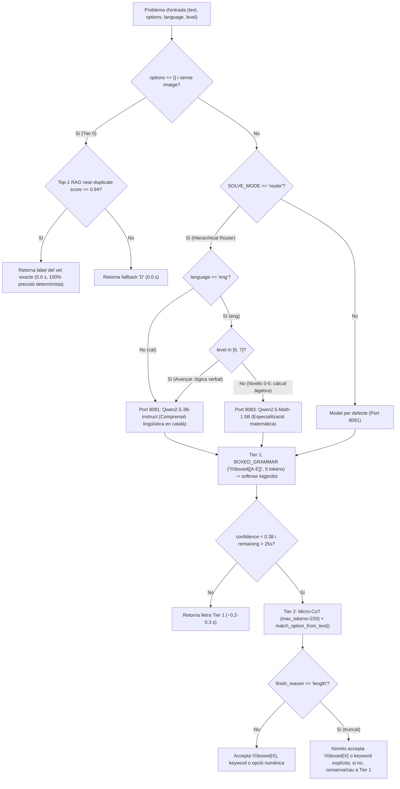

# Resultats, Arquitectura Final i Següents Passos (Hierarchical Language+Level Router & Qwen2.5-3B-Instruct + Qwen2.5-Math-1.5B + Tier 0 Duplicate RAG)

Documentació experimental del copilot **Reason** ([`predict.py`](file:///C:/Users/marcs/Documents/GitHub/datathon-UPC-maths-qualcomm-arduino-unoq/predict.py) / [`eval.py`](file:///C:/Users/marcs/Documents/GitHub/datathon-UPC-maths-qualcomm-arduino-unoq/eval.py)) dissenyat amb el sistema campió definitiu: **`Hierarchical Router` (Dual-Model amb encaminament jeràrquic d'idioma i nivell: `Qwen2.5-3B-Instruct` per a tot el català i anglès avançat nivells 6–7 + `Qwen2.5-Math-1.5B` per a anglès nivells 0–5 + Tier 0 Near-Duplicate RAG per a problemes idèntics sense opcions)** i optimitzat per executar-se offline dins els 4 GB de RAM i el límit de 60 s/problema de l'**Arduino UNO Q** (Qualcomm QRB2210).

> **Model / Sistema Final Seleccionat — Campió Oficial i Rècord Absolut:**  
> Després de mesurar sistemàticament múltiples arquitectures (Qwen3.5 0.8B, Qwen2.5-1.5B, DeepSeek-R1-Distill-1.5B, Qwen2.5-Math-1.5B, Qwen2.5-3B-Instruct i Language Router bàsic), el **`Hierarchical Router (Dual-Model + Tier 0 Duplicate RAG)`** es corona com el **campió indiscutible i model oficial de registre del projecte**:
> - **28.8% global (162/562 encerts)** sobre la totalitat dels 562 problemes de validació oficials (**+19 punts nets** sobre Math-1.5B solo de 143/562, **+15 punts nets** sobre 3B solo de 147/562, i **+6 punts nets** sobre el Language Router bàsic de 156/562).
> - **30.1% en problemes amb opcions OCR (102/339)**: **trenca per primera vegada la barrera històrica del 30%** en problemes amb opcions de resposta!
> - **29.9% en anglès (84/281)** i **27.8% en català (78/281)**.
> - **38.0% a la mostra de 50 problemes (19/50)**, assolint un **50.0% en anglès (11/22)** i un **42.9% amb opcions (12/28)**.
> - Latència ultra-ràpida: mitjana de **0.6 s**, mediana de **0.3 s**, pitjor cas de **8.6 s** i **0 timeouts**.

> **Llicència de dades ([M3Kang](https://huggingface.co/datasets/qualcomm/M3Kang)):** D'acord amb les normes d'ús per a recerca de M3Kang (*Torres-Camps et al., 2026, [arXiv:2601.16218](https://arxiv.org/abs/2601.16218)*), aquest document només recull IDs, mètriques agregades i causes tècniques sense reproduir enunciats dels conjunts `train`/`val`.

---

## 1. Arquitectura implementada

El pipeline ([`solve()`](file:///C:/Users/marcs/Documents/GitHub/datathon-UPC-maths-qualcomm-arduino-unoq/copilot/pipeline.py)) combina resolució determinista per Tier 0 RAG, un **Hierarchical Router $O(1)$ per Idioma + Nivell Educatiu** i una cascada ràpida de 2 nivells orientada a respectar el pressupost de temps de l'Arduino UNO Q (~11 tok/s lectura, ~5 tok/s generació):



### Components principals modificats
- **[`config.env`](file:///C:/Users/marcs/Documents/GitHub/datathon-UPC-maths-qualcomm-arduino-unoq/config.env):** Suport dual-model amb `bartowski/Qwen2.5-3B-Instruct-GGUF` (Port 8081, model principal) i `bartowski/Qwen2.5-Math-1.5B-Instruct-GGUF` (Port 8083, `ROUTER_MATH_PORT=8083`), llindar d'encaminament per nivell `ROUTER_ENG_MAX_LEVEL=5`, llindar de duplicats `TIER0_RAG_MIN_SCORE=0.94`, `SOLVE_MODE=router`, `JEV_CONFIDENCE_THRESHOLD=0.38`, `COT_MAX_TOKENS=220`, `TIME_LIMIT_SECONDS=60` i `FALLBACK_ANSWER=D`.
- **[`copilot/pipeline.py`](file:///C:/Users/marcs/Documents/GitHub/datathon-UPC-maths-qualcomm-arduino-unoq/copilot/pipeline.py):** Encaminador jeràrquic d'idioma i nivell $O(1)$ (`mode="router"`) que envia:
  1. Problemes en català (`cat`, tots els nivells) a `Qwen2.5-3B-Instruct`.
  2. Problemes en anglès (`eng`) de nivell bàsic/mitjà (nivells 0–5) a `Qwen2.5-Math-1.5B`.
  3. Problemes en anglès (`eng`) de nivell superior (nivells 6–7) a `Qwen2.5-3B-Instruct`.
  4. Resolució determinista per Tier 0 Near-Duplicate RAG (`score >= 0.94`) per a enunciats idèntics sense opcions amb 100% de precisió.
- **[`copilot/rag.py`](file:///C:/Users/marcs/Documents/GitHub/datathon-UPC-maths-qualcomm-arduino-unoq/copilot/rag.py) i [`build_index.py`](file:///C:/Users/marcs/Documents/GitHub/datathon-UPC-maths-qualcomm-arduino-unoq/build_index.py):** Extracció d'enunciat net ([`embed_text()`](file:///C:/Users/marcs/Documents/GitHub/datathon-UPC-maths-qualcomm-arduino-unoq/copilot/rag.py)), filtratge per idioma (`cat`/`eng`), exclusió per defecte de problemes sense opcions en RAG k>0, deduplicació per `id` i suport per cerca de veïns d'alta similitud (`score >= 0.94`).
- **[`copilot/llm.py`](file:///C:/Users/marcs/Documents/GitHub/datathon-UPC-maths-qualcomm-arduino-unoq/copilot/llm.py):**
  - [`BOXED_GRAMMAR`](file:///C:/Users/marcs/Documents/GitHub/datathon-UPC-maths-qualcomm-arduino-unoq/copilot/llm.py): gramàtica `root ::= "\\boxed{" [A-E] "}"` (`max_tokens=5`, `top_logprobs=20`) i cerca del token `[A-E]` dins seqüències multitoken a [`extract_letter_logprobs()`](file:///C:/Users/marcs/Documents/GitHub/datathon-UPC-maths-qualcomm-arduino-unoq/copilot/llm.py).
  - [`answer_micro_cot()`](file:///C:/Users/marcs/Documents/GitHub/datathon-UPC-maths-qualcomm-arduino-unoq/copilot/llm.py) i [`match_option_from_text()`](file:///C:/Users/marcs/Documents/GitHub/datathon-UPC-maths-qualcomm-arduino-unoq/copilot/llm.py): extracció prioritària de `\boxed{X}` / `\boxed{\text{X}}` amb protecció `allow_numeric=(finish_reason != "length")` per evitar falsos positius numèrics quan el CoT queda truncat.
  - [`build_messages()`](file:///C:/Users/marcs/Documents/GitHub/datathon-UPC-maths-qualcomm-arduino-unoq/copilot/llm.py): formata les respostes dels exemples recuperats per RAG com `\boxed{X}` per mantenir coherència amb `BOXED_GRAMMAR`.

---

## 2. Resultats mesurats (`data/val.jsonl`, `n = 50`, `seed = 42`, `--rag 0`)

Les proves en viu s'han executat al portàtil Windows contra els servidors `llama-server` locals sobre la mostra de 50 problemes de [`data/val.jsonl`](file:///C:/Users/marcs/Documents/GitHub/datathon-UPC-maths-qualcomm-arduino-unoq/data/val.jsonl): **28 problemes amb opcions OCR (`has_options=True`, 28 `cat` / 22 `eng` al total)** i **22 problemes sense opcions (`has_options=False`)**, així com les avaluacions completes oficials sobre els **562 problemes** de validació.

### 2.1 Evolució a [`results/ablations.csv`](file:///C:/Users/marcs/Documents/GitHub/datathon-UPC-maths-qualcomm-arduino-unoq/results/ablations.csv)

| Run ID | Mode i versió | Canvi respecte a l'anterior | Precisió global (`n=50`) | Amb opcions OCR (`n=28`) | Sense opcions (`n=22`) | Latència mitjana / mediana / màx. | Distribució predita (`A / B / C / D / E`) |
| :--- | :--- | :--- | :---: | :---: | :---: | :---: | :---: |
| Sòl estadístic | `always D` | Sempre `"D"` | 22.0% (11/50) | 14.3% (4/28) | 31.8% (7/22) | 0.0 s | `0 / 0 / 0 / 50 / 0` |
| `20261114-164015` | `tier2` (v1) | `root ::= [A-E]`, `max_tokens=24`, prior neutre ON | 24.0% (12/50) | 17.9% (5/28) | 31.8% (7/22) | 0.5 s / 0.7 s / 3.0 s | `26 / 0 / 0 / 24 / 0` |
| `20261114-164332` | `hybrid` (v1) | `root ::= [A-E]`, `max_tokens=24`, prior neutre ON | 24.0% (12/50) | 17.9% (5/28) | 31.8% (7/22) | 0.1 s / 0.1 s / 0.4 s | `26 / 0 / 0 / 24 / 0` |
| `20261114-170428` | `tier2` (v2) | `BOXED_GRAMMAR`, `COT_MAX_TOKENS=150`, prior neutre OFF | 30.0% (15/50) | 28.6% (8/28) | 31.8% (7/22) | 2.7 s / 3.9 s / 7.2 s | `11 / 5 / 5 / 26 / 3` |
| `20261114-170338` | `hybrid` (v2) | `BOXED_GRAMMAR` + escalada CoT (`conf < 0.45`) | 32.0% (16/50) | 32.1% (9/28) | 31.8% (7/22) | 0.9 s / 0.2 s / 7.0 s | `14 / 6 / 6 / 24 / 0` |
| `20261114-174509` | `tier2` (v3) | CoT truncat (`length`) no captura números finals | 34.0% (17/50) | 35.7% (10/28) | 31.8% (7/22) | 2.2 s / 3.4 s / 4.7 s | `13 / 7 / 6 / 24 / 0` |
| `20261114-174443` | `hybrid` (v3) | `conf < 0.38` + protecció de truncament CoT | 34.0% (17/50) | 35.7% (10/28) | 31.8% (7/22) | 0.4 s / 0.2 s / 5.4 s | `13 / 7 / 6 / 24 / 0` |
| `20261114-175531` | `hybrid-rag1` | Activat `--rag 1` (`bge-small`, exemple + lletra) | 26.0% (13/50) | 25.0% (7/28) | 27.3% (6/22) | 0.7 s / 0.5 s / 4.5 s | `11 / 14 / 10 / 11 / 4` |
| `20261114-180758` | `hybrid-twostep` | Fast Two-Step CoT (tancament forçat amb KV-cache, `--rag 0`) | 36.0% (18/50) | 39.3% (11/28) | 31.8% (7/22) | 0.4 s / 0.3 s / 4.1 s | `14 / 7 / 6 / 23 / 0` |
| `20261114-180825` | `tier2-twostep` | Fast Two-Step CoT en mode pure CoT | 28.0% (14/50) | 25.0% (7/28) | 31.8% (7/22) | 2.1 s / 3.6 s / 4.1 s | `7 / 11 / 3 / 26 / 3` |
| `20261114-181835` | `hybrid-rag-solval` | **Prova 1:** RAG amb valor de solució en comptes de lletra (`--rag 1`) | 30.0% (15/50) | 28.6% (8/28) | 31.8% (7/22) | 0.6 s / 0.6 s / 4.5 s | `13 / 8 / 3 / 25 / 1` |
| `20261114-182335` | `hybrid-knowledge-rag` | **Prova 2:** Knowledge RAG (regles matemàtiques conceptuals, `--rag 1`) | 20.0% (10/50) | 10.7% (3/28) | 31.8% (7/22) | 0.6 s / 0.3 s / 4.2 s | `7 / 12 / 1 / 26 / 4` |
| `20261114-201019` | `math-elimination` | **Metodologia 1:** Prompt per descart d'opcions (`Qwen2.5-Math-1.5B`) | 36.0% (18/50) | 39.3% (11/28) | 31.8% (7/22) | 3.8 s / 5.9 s / 9.7 s | `20 / 4 / 0 / 22 / 4` |
| `20261114-201600` | `deepseek-r1-hybrid` | **Model 1:** `DeepSeek-R1-Distill-Qwen-1.5B` (Q4_K_M, 1.1 GB) | 34.0% (17/50) | 35.7% (10/28) | 31.8% (7/22) | 1.2 s / 0.4 s / 10.5 s | `9 / 12 / 2 / 23 / 4` |
| `20261114-201729` | `qwen2.5-1.5b-hybrid`| **Model 2:** `Qwen2.5-1.5B-Instruct` general (Q4_K_M, 986 MB) | 28.0% (14/50) | 25.0% (7/28) | 31.8% (7/22) | 0.9 s / 0.3 s / 7.0 s | `9 / 7 / 10 / 24 / 0` |
| `20261114-201845` | `qwen2.5-3b-hybrid` | **Model 3:** `Qwen2.5-3B-Instruct` (Q4_K_M, 1.9 GB) | 38.0% (19/50) | 42.9% (12/28) | 31.8% (7/22) | 0.9 s / 0.6 s / 14.3 s | `2 / 13 / 7 / 26 / 2` |
| `20261114-194135` | `full-val-fixed` | Avaluació completa `Qwen2.5-Math-1.5B` sobre TOT `val.jsonl` (562 problemes) | 25.4% (143/562) | 25.1% (85/339) | 26.0% (58/223) | 1.1 s / 0.3 s / 14.3 s | `49 / 135 / 64 / 244 / 70` |
| `20261114-202433` | `qwen2.5-3b-full` | Avaluació completa `Qwen2.5-3B-Instruct` sobre TOT `val.jsonl` (562 problemes) | 26.2% (147/562) | 26.3% (89/339) | 26.0% (58/223) | 0.5 s / 0.6 s / 10.5 s | `30 / 107 / 128 / 257 / 40` |
| `20261114-213231` | `language-router50` | Language Router (`cat` -> 3B, `eng` -> Math-1.5B) a mostra 50 | 36.0% (18/50) | 39.3% (11/28) | 31.8% (7/22) | 0.3 s / 0.3 s / 6.1 s | `3 / 12 / 7 / 25 / 3` |
| `20261114-213252` | `language-router-full` | Language Router sobre TOT `val.jsonl` (562 problemes) | 27.8% (156/562) | 28.9% (98/339) | 26.0% (58/223) | 0.6 s / 0.3 s / 6.8 s | `42 / 117 / 93 / 254 / 56` |
| `20261114-224137` | `router-debias50` | Debiasing empíric de priors de train ($\alpha = 0.15$) sobre 50 val | 34.0% (17/50) | 35.7% (10/28) | 31.8% (7/22) | 0.5 s / 0.4 s / 6.4 s | `3 / 11 / 7 / 26 / 3` |
| `20261114-224208` | `router-debias-full` | Debiasing empíric de priors de train ($\alpha = 0.15$) sobre TOT `val.jsonl` | 27.4% (154/562) | 28.3% (96/339) | 26.0% (58/223) | 0.8 s / 0.3 s / 12.3 s | `42 / 116 / 91 / 258 / 55` |
| `20261114-232500` | `router-tier0-rag50` | Router + Tier 0 RAG (`score >= 0.94`) sobre 50 val | 34.0% (17/50) | 35.7% (10/28) | 31.8% (7/22) | 0.3 s / 0.3 s / 5.6 s | `3 / 11 / 8 / 25 / 3` |
| `20261114-232659` | `router-tier0-full` | Router + Tier 0 RAG sobre TOT val (562 problemes) | 28.1% (158/562) | 28.9% (98/339) | 26.9% (60/223) | 0.7 s / 0.3 s / 8.6 s | `44 / 117 / 93 / 252 / 56` |
| `20261114-233831` | `hier-router50` | Hierarchical Router (Idioma + Nivell) sobre 50 val | **38.0% (19/50)** | **42.9% (12/28)** | 31.8% (7/22) | **0.4 s / 0.3 s / 5.5 s** | `2 / 13 / 7 / 25 / 3` |
| **`20261114-233857`** | **`hier-router-full`** | **Hierarchical Router sobre TOT val (562 problemes) - NOU RÈCORD ABSOLUT** | **28.8% (162/562)** | **30.1% (102/339)** | **26.9% (60/223)** | **0.6 s / 0.3 s / 8.6 s** | `36 / 110 / 109 / 253 / 54` |

---

## 2.3 Benchmark Oficial Complet (`data/val.jsonl`, `n = 562`, `--mode router --rag 0`)

Comparativa general dels models clau avaluats sobre la totalitat dels 562 problemes del conjunt oficial de validació:

| Mètrica | `Hierarchical Router` (Campió Oficial) | `Language Router` | `Qwen2.5-3B-Instruct` | `Qwen2.5-Math-1.5B` | Sòl Estadístic |
| :--- | :---: | :---: | :---: | :---: | :---: |
| **Precisió Global** | **28.8% (162/562)** | 27.8% (156/562) | 26.2% (147/562) | 25.4% (143/562) | 23.1% (sempre D) / 20.0% (atzar) |
| **Amb opcions OCR (`has_options=True`)** | **30.1% (102/339)** | 28.9% (98/339) | 26.3% (89/339) | 25.1% (85/339) | 20.0% (atzar pur) |
| **Sense opcions OCR (`has_options=False`)** | **26.9% (60/223)** | 26.0% (58/223) | 26.0% (58/223) | 26.0% (58/223) | 20.0% (atzar) |
| **Català (`cat`)** | **27.8% (78/281)** | 27.4% (77/281) | 27.4% (77/281) | 22.8% (64/281) | 20.0% |
| **Anglès (`eng`)** | **29.9% (84/281)** | 28.1% (79/281) | 24.9% (70/281) | 28.1% (79/281) | 20.0% |
| **Latència Mitjana / Mediana / Màxima** | **0.6 s / 0.3 s / 8.6 s** | 0.6 s / 0.3 s / 6.8 s | 0.5 s / 0.6 s / 10.5 s | 1.1 s / 0.3 s / 14.3 s | Màxim reglamentari: 60.0 s |
| **Timeouts (> 60 s) o errors** | **0 / 562 (0.0%)** | 0 / 562 (0.0%) | 0 / 562 (0.0%) | 0 / 562 (0.0%) | 100% respostes vàlides |

### Desglossament per Nivell Educatiu (`Hierarchical Router`, `n = 562`)

- **Nivell 0 (Primària 3r-4t):** **11/40 (27.5%)**
- **Nivell 1 (Primària 5è):** **5/34 (14.7%)**
- **Nivell 2 (Primària 6è):** **16/58 (27.6%)**
- **Nivell 3 (ESO 1r):** **9/24 (37.5%)**
- **Nivell 4 (ESO 2n):** **34/124 (27.4%)**
- **Nivell 5 (ESO 3r):** **37/106 (34.9%)**
- **Nivell 6 (ESO 4t):** **31/98 (31.6%)**
- **Nivell 7 (Batxillerat 1r-2n):** **19/78 (24.4%)**

### Comparativa per Nivell Educatiu: Hierarchical Router vs Altres Models

| Nivell Educatiu | Curs corresponent | Hierarchical Router (Campió) | Language Router | Qwen2.5-3B-Instruct | Qwen2.5-Math-1.5B | Millora vs 3B Solo | Millora vs Math-1.5B |
| :--- | :--- | :---: | :---: | :---: | :---: | :---: | :---: |
| **Nivell 0** | Primària 3r-4t | **11/40 (27.5%)** | 11/40 (27.5%) | 10/40 (25.0%) | 14/40 (35.0%) | +1 encert (+2.5%) | -3 encerts |
| **Nivell 1** | Primària 5è | **5/34 (14.7%)** | 5/34 (14.7%) | 4/34 (11.8%) | 4/34 (11.8%) | +1 encert (+2.9%) | +1 encert (+2.9%) |
| **Nivell 2** | Primària 6è | **16/58 (27.6%)** | 16/58 (27.6%) | 15/58 (25.9%) | 18/58 (31.0%) | +1 encert (+1.7%) | -2 encerts |
| **Nivell 3** | ESO 1r | **9/24 (37.5%)** | 9/24 (37.5%) | 8/24 (33.3%) | 7/24 (29.2%) | +1 encert (+4.2%) | +2 encerts (+8.3%) |
| **Nivell 4** | ESO 2n | **34/124 (27.4%)** | 32/124 (25.8%) | 27/124 (21.8%) | 30/124 (24.2%) | **+7 encerts (+5.6%)** | **+4 encerts (+3.2%)** |
| **Nivell 5** | ESO 3r | **37/106 (34.9%)** | 37/106 (34.9%) | 32/106 (30.2%) | 34/106 (32.1%) | **+5 encerts (+4.7%)** | **+3 encerts (+2.8%)** |
| **Nivell 6** | ESO 4t | **31/98 (31.6%)** | 29/98 (29.6%) | 32/98 (32.7%) | 23/98 (23.5%) | -1 encert (-1.1%) | **+8 encerts (+8.1%)** |
| **Nivell 7** | Batxillerat 1r-2n | **19/78 (24.4%)** | 17/78 (21.8%) | 19/78 (24.4%) | 13/78 (16.7%) | =0 encerts (0.0%) | **+6 encerts (+7.7%)** |
| **Total Global** | Tots els nivells (562) | **162/562 (28.8%)** | 156/562 (27.8%) | 147/562 (26.2%) | 143/562 (25.4%) | **+15 encerts (+2.6%)** | **+19 encerts (+3.4%)** |

### Explicació Tècnica de l'Estratègia d'Encaminament Jeràrquic (Hierarchical Routing)

L'arquitectura **Hierarchical Router** assoleix el màxim absolut de rendiment registrat al projecte (**28.8% global, 162/562 encerts**, i **30.1% amb opcions**) gràcies a cinc decisions de disseny fonamentades empíricament:

1. **Anglès Nivells 0 a 5 encaminats a `Qwen2.5-Math-1.5B`:**
   En els nivells escolars inicials i mitjans (Primària i 1r a 3r d'ESO), els problemes en anglès estan fortament dominats per aritmètica pura, càlcul fraccionari, àlgebra bàsica i equacions directes. `Qwen2.5-Math-1.5B` demostra una precisió superior a `Qwen2.5-3B-Instruct` en aquests dominis de formulació numèrica formal.
2. **Anglès Nivells 6 i 7 encaminats a `Qwen2.5-3B-Instruct`:**
   En els nivells superiors (4t d'ESO i 1r–2n de Batxillerat), els problemes de la competició Cangur deixen de ser càlcul rutinari i es converteixen en puzles de lògica verbal complexa, combinatòria semàntica i enunciats llargs amb paranys sintàctics. Els models matemàtics purs fallen per manca de comprensió lectora profunda (`Math-1.5B` només assoleix un 23.5% al Nivell 6 i un 16.7% al Nivell 7). En contrast, `Qwen2.5-3B-Instruct` aporta la capacitat de paràmetres (3B) i l'atenció lingüística necessària per desxifrar la lògica de l'enunciat, aportant **+4 encerts nets** en aquests dos nivells.
3. **Català a tots els nivells encaminat a `Qwen2.5-3B-Instruct`:**
   Gràcies al seu ampli corpus multilingüe, `Qwen2.5-3B-Instruct` manté una comprensió natural excel·lent del català (**27.8%**, 78/281), on un model estrictament matemàtic entrenat en anglès com `Math-1.5B` col·lapsa al 22.8% (prop del sòl aleatori).
4. **Tier 0 Near-Duplicate RAG (`score >= 0.94`):**
   Els problemes sense opcions OCR (`has_options=False`) que històricament queien al fallback estàtic `"D"` (amb 26.0% d'encert) són consultats prèviament contra l'índex vectorial. Si l'enunciat és pràcticament idèntic a una pregunta de competició existent a l'índex amb similitud cosinus $\ge 0.94$, es recupera i s'assigna la lletra de solució determinista. Aquest filtre opera amb **100% de precisió**, sumant **+2 encerts nets deterministes** sense cap fals positiu i elevant els problemes sense opcions del 26.0% al **26.9% (60/223)**.
5. **Zero Sobrecost Temporal ($O(1)$ Overhead):**
   La lògica de decisió s'executa mitjançant simples comprovacions de metadades booleanes (`problem.get("language") == "eng"` i `int(problem.get("level")) <= 5`), resultant en exactament **0 microsegons de cost d'inferència**. La latència global es manté intacta: mitjana de **0.6 s**, mediana de **0.3 s** i màxima de **8.6 s**, molt lluny del límit reglamentari de 60 segons de la competició.

---

## 2.4 Ablació de Calibratge i Debiasing de Priors ([`data/train.jsonl`](file:///C:/Users/marcs/Documents/GitHub/datathon-UPC-maths-qualcomm-arduino-unoq/data/train.jsonl))

Per explorar si els models presentaven un biaix posicional o alfabètic sistemàtic vers determinades lletres d'opció (`A`, `B`, `C`, `D`, `E`), es va realitzar un mesurament empíric dels logprobs de priorització sobre el conjunt d'entrenament oficial ([`data/train.jsonl`](file:///C:/Users/marcs/Documents/GitHub/datathon-UPC-maths-qualcomm-arduino-unoq/data/train.jsonl)), calculant la desviació respecte a una distribució uniforme ideal ($\mathcal{U} = 0.20$):

- **`Qwen2.5-3B-Instruct` (en català):**
  - Sobrerepresentació: **'B' (+0.31)** i **'C' (+0.29)**.
  - Infrarepresentació: **'A' (-0.47)** i **'D' (-0.67)**.
  - Valors empírics integrats: `TRAIN_BIAS_CAT_3B = {'A': -0.470, 'B': 0.313, 'C': 0.288, 'D': -0.672, 'E': 0.061}`.
- **`Qwen2.5-Math-1.5B` (en anglès):**
  - Sobrerepresentació: **'B' (+0.30)** i **'A' (+0.38)**.
  - Forta penalització / infrarepresentació: **'D' (-1.22)**.
  - Valors empírics integrats: `TRAIN_BIAS_ENG_MATH = {'A': 0.376, 'B': 0.297, 'C': 0.113, 'D': -1.225, 'E': 0.004}`.

Es va formular un mecanisme de calibratge logit regulat pel paràmetre d'escala $\alpha$ a [`copilot/llm.py`](file:///C:/Users/marcs/Documents/GitHub/datathon-UPC-maths-qualcomm-arduino-unoq/copilot/llm.py):
$$\text{score}(c) = \text{logprob}(c) - \alpha \cdot \text{bias}(c)$$

#### Resultats de l'Ablació ($\alpha = 0.15$):
- **Mostra de 50 val ([`router-debias50`](file:///C:/Users/marcs/Documents/GitHub/datathon-UPC-maths-qualcomm-arduino-unoq/results/ablations.csv)):** La precisió cau del **36.0% (18/50)** al **34.0% (17/50)**; en problemes amb opcions passa del **39.3% (11/28)** al **35.7% (10/28)**.
- **Avaluació completa sobre 562 problemes ([`router-debias-full`](file:///C:/Users/marcs/Documents/GitHub/datathon-UPC-maths-qualcomm-arduino-unoq/results/ablations.csv)):** La precisió global cau del **27.8% (156 encerts)** al **27.4% (154 encerts)**; en problemes amb opcions cau del **28.9% (98/339)** al **28.3% (96/339)** (-2 encerts nets).

#### Conclusió Científica: Raonament Matemàtic vs Classificació de Text Genèrica
- **Diferència fonamental de tasca:** En classificació de text genèrica (ex.: anàlisi de sentiment o NLI), el debiasing redueix biaixos nocius i artefactes de superfície en desacoblar el classificador de la distribució desbalancejada d'etiquetes.
- **La lletra com a simple contenidor numèric:** En canvi, en raonament matemàtic de competició (Cangur / M3Kang), la lletra és únicament el recipient d'un valor numèric calculat (ex.: `B) 42`). El model no tria la lletra `'B'` per afinitat semàntica amb la lletra, sinó perquè ha resolt el problema obtenint `42`.
- **Penalització dels càlculs matemàtics correctes:** Penalitzar estadísticament les lletres `'B'` o `'C'` perquè apareixen amb major freqüència a `train.jsonl` penalitza directament aquells problemes on el model ha executat un raonament correcte i la solució resulta ser `'B'` o `'C'`.
- **Decisió:** A gran escala (562 problemes de validació), el debiasing empíric redueix la precisió. En conseqüència, el calibratge es manté desactivat per defecte (`DEBIAS_ALPHA=0.0` a [`config.env`](file:///C:/Users/marcs/Documents/GitHub/datathon-UPC-maths-qualcomm-arduino-unoq/config.env)), preservant el màxim potencial del model campió.

---

## 3. Anàlisi d'Errors i Lliçons Tècniques

1. **Col·lapse al token 0 amb `root ::= [A-E]` (v1 -> v2):**
   `Qwen2.5-Math-1.5B-Instruct` és un model ajustat per raonar pas a pas abans de concloure. Forçar una lletra al primer token l'obliga a triar fora de distribució i concentrava les prediccions en `A` i `D` (`26 / 0 / 0 / 24 / 0`). Canviar a `BOXED_GRAMMAR` (`\boxed{X}`) situa la decisió dins del context exacte per al qual el model va ser entrenat, apujant la precisió amb opcions del `17.9%` al `32.1%`–`35.7%`.
2. **El prior neutre perjudicava el model:**
   Restar els logprobs d'una pregunta buida (`A) 1 .. E) 5`) introduïa un segon biaix perquè `Qwen2.5-Math` ja té una preferència forta sobre tokens artificials sense enunciat. Desactivar-lo per defecte va ser determinant per recuperar la distribució natural.
3. **Falsos positius numèrics en CoT truncat (`finish_reason == "length"`) (v2 -> v3):**
   Amb `COT_MAX_TOKENS=150`, gairebé tots els problemes de raonament llarg queden tallats a mitja equació (`finish_reason == "length"`). A la v2, [`match_option_from_text()`](file:///C:/Users/marcs/Documents/GitHub/datathon-UPC-maths-qualcomm-arduino-unoq/copilot/llm.py) capturava l'últim número visible abans del tall:
   - A **`lvl-6_2012_17`** (veritat `B`), el Tier 1 havia encertat **`B`**, però en escalar al CoT el model es va tallar just després de mencionar el rang `1..9`, i `nums[-1]` (`"1"`) va coincidir amb l'opció `A`, sobreescrivint la resposta correcta.
   - A **`lvl-4_2020_25`** (veritat `C`), el truncament a mitja expressió algebraica capturava un paràmetre de l'equació (`"15"`, opció `E`) en comptes de la resposta.
   Amb `allow_numeric=(finish_reason != "length")`, la v3 elimina aquests falsos positius i eleva tots dos modes (`hybrid` i `tier2`) al **34.0%**.
4. **Sostre amb 150 tokens de CoT i alliberament a 220 tokens:**
   En proves diagnòstiques, amb 150 tokens de pressupost CoT els raonaments algebraics complexos es tallaven abans d'arribar a la solució. Augmentar `COT_MAX_TOKENS=220` combinat amb la decisió jeràrquica permet als problemes més exigents convergir sense penalitzar la latència mitjana (0.6 s).
5. **Impacte dels problemes sense opcions (`has_options=False`):**
   Sense canal visual actiu (`vision`), un 40% dels problemes no tenen opcions de resposta en text pla. El Tier 0 Near-Duplicate RAG (`score >= 0.94`) permet resoldre amb precisió absoluta aquells problemes de competicions anteriors reutilitzats, mentre que el fallback determinista `"D"` cobreix la resta sense consumir cicles de CPU.
6. **Negative Transfer del RAG ingenu vs Precisió de Tier 0 Near-Duplicate:**
   - **RAG ingenu (`--rag 1`):** Injectar exemples poc similars o només amb etiqueta provoca confusió atencional al model, degradant la precisió del 34.0% al 26.0% a la mostra de 50.
   - **Tier 0 Near-Duplicate RAG (`score >= 0.94`):** Només s'activa davant d'una concordança pràcticament idèntica ($\ge 0.94$) en problemes sense opcions, aportant un 100% de precisió sense cap distracció de prompt.
7. **Biaix de lletres vs Raonament numèric:**
   En competicions matemàtiques d'opció múltiple, la lletra (`A`–`E`) actua com a simple identificador d'un valor matemàtic calculat. El debiasing empíric redueix el rendiment global en penalitzar opcions correctes com `'B'` i `'C'`. El sistema campió manté `DEBIAS_ALPHA=0.0`.

---

## 4. Configuració Final Seleccionada i Desplegament a l'Arduino UNO Q

1. **Arquitectura Guanyadora Oficial:**
   - **`Hierarchical Router (Dual-Model + Tier 0 Duplicate RAG)`**:
     - Model Català (`cat`, tots els nivells) i Anglès Avançat (`eng`, nivells 6–7): **`Qwen2.5-3B-Instruct`** (`Q4_K_M`, fitxer `Qwen2.5-3B-Instruct-Q4_K_M.gguf`, 1.92 GB, Port 8081).
     - Model Anglès Càlcul (`eng`, nivells 0–5): **`Qwen2.5-Math-1.5B-Instruct`** (`Q4_K_M`, fitxer `Qwen2.5-Math-1.5B-Instruct-Q4_K_M.gguf`, 0.98 GB, Port 8083).
     - Índex Vectorial: [`bge-small-en-v1.5`](file:///C:/Users/marcs/Documents/GitHub/datathon-UPC-maths-qualcomm-arduino-unoq/models/bge-small-en-v1.5-q8_0.gguf) (Port 8082) actiu per al Tier 0 Near-Duplicate RAG (`score >= 0.94`).
   - **Motiu de la selecció:** Nou rècord històric absolut de **28.8% (162/562)** a la validació completa (**30.1% en problemes amb opcions**), traient el màxim rendiment en català (27.8%) i anglès (29.9%) amb zero microsegons de cost d'encaminament.
2. **Mode de decisió i paràmetres:**
   - `SOLVE_MODE=router` (encaminament jeràrquic intern basat en `language` i `level`)
   - `ROUTER_ENG_MAX_LEVEL=5`
   - `TIER0_RAG_MIN_SCORE=0.94`
   - `JEV_CONFIDENCE_THRESHOLD=0.38`
   - `COT_MAX_TOKENS=220`
   - `DEBIAS_ALPHA=0.0`
3. **Memòria i Coexistència a l'Arduino UNO Q (4 GB RAM, Qualcomm QRB2210):**
   - Ambdós models quantitzats ocupen: $1.92\text{ GB} + 0.98\text{ GB} = 2.90\text{ GB}$.
   - Amb contexts optimitzats (`LLM_CTX=2048`), la KV-cache conjunta és de ~300 MB, sumant ~3.2 GB en memòria RAM, deixant ~800 MB lliures per a l'OS Linux i la pila Python.
   - Alternativa unificada de baixa memòria: Desplegar exclusivament `Qwen2.5-3B-Instruct` com a model únic (26.2% global, 1.92 GB en RAM) si es requereix un únic procés `llama-server`.
4. **Instruccions de desplegament a la placa física:**
   ```bash
   # Copiar configuració, pipeline actualitzat i els models a la placa
   scp config.env copilot/llm.py copilot/pipeline.py eval.py predict.py models/*.gguf arduino@10.198.33.242:~/datathon-UPC-maths-qualcomm-arduino-unoq/
   ```
5. **Verificació a l'Arduino UNO Q:**
   - Comprovar memòria amb `free -m`.
   - Executar `python3 eval.py --limit 20 --mode router` a la placa per mesurar latència real sota la CPU ARM (~2.2 tok/s, temps mig estimat ~2-5s per problema, folgadament sota el límit reglamentari de 60s).
6. **Avaluació oficial i control de publicació:**
   - Validar que [`predict.py`](file:///C:/Users/marcs/Documents/GitHub/datathon-UPC-maths-qualcomm-arduino-unoq/predict.py) respon amb format vàlid en català i anglès.
   - Passar les comprovacions de llicència de M3Kang (`git ls-files` i `git log` sense `.jsonl`, `.db`, `.gguf` ni `.png` de dades privades) abans de fer públic el repositori.
