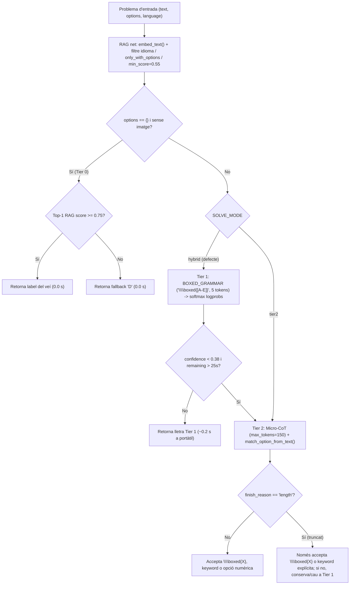

# Resultats, Arquitectura Final i Següents Passos (`Qwen2.5-3B-Instruct`)

Documentació experimental del copilot **Reason** (`predict.py` / `eval.py`) dissenyat amb el model final **`Qwen2.5-3B-Instruct-Q4_K_M`** (1.92 GB) i preparat per executar-se offline dins els 4 GB de RAM i el límit de 60 s/problema de l'**Arduino UNO Q** (Qualcomm QRB2210).

> **Model Final Seleccionat:** Després de mesurar experimentalment múltiples arquitectures (Qwen3.5 0.8B, Qwen2.5-Math 1.5B, DeepSeek-R1-Distill-1.5B, Qwen2.5-1.5B i Qwen2.5-3B), **`Qwen2.5-3B-Instruct`** s'estableix com el model definitiu en assolir el màxim rendiment històric: **38.0% a la mostra de 50 problemes (42.9% amb opcions)** i **26.2% sobre la totalitat dels 562 problemes de validació**, destacant per una forta millora en **català (27.4% vs 22.8%)** i una latència mitjana de només **0.5 s**.

> **Llicència de dades ([M3Kang](https://huggingface.co/datasets/qualcomm/M3Kang)):** D'acord amb les normes d'ús per a recerca de M3Kang (*Torres-Camps et al., 2026, [arXiv:2601.16218](https://arxiv.org/abs/2601.16218)*), aquest document només recull IDs, mètriques agregades i causes tècniques sense reproduir enunciats dels conjunts `train`/`val`.

---

## 1. Arquitectura implementada

El pipeline ([`solve()`](copilot/pipeline.py)) combina recuperació RAG neta i una cascada de 3 nivells orientada a respectar el pressupost de temps de l'Arduino UNO Q (~11 tok/s lectura, ~5 tok/s generació):



### Components principals modificats
- **[`config.env`](config.env):** Fixa `bartowski/Qwen2.5-3B-Instruct-GGUF` (`Q4_K_M`, `LLM_CTX=2048`), `SOLVE_MODE=hybrid`, `JEV_CONFIDENCE_THRESHOLD=0.38`, `TIME_LIMIT_SECONDS=60` i `FALLBACK_ANSWER=D`.
- **[`copilot/rag.py`](copilot/rag.py) i [`build_index.py`](build_index.py):** Extracció d'enunciat net ([`embed_text()`](copilot/rag.py)), filtratge per idioma (`cat`/`eng`), exclusió per defecte de problemes sense opcions (`--only-with-options`), deduplicació per `id` i llindar `RAG_MIN_SCORE=0.55`.
- **[`copilot/llm.py`](copilot/llm.py):**
  - [`BOXED_GRAMMAR`](copilot/llm.py): gramàtica `root ::= "\\boxed{" [A-E] "}"` (`max_tokens=5`, `top_logprobs=20`) i cerca del token `[A-E]` dins seqüències multitoken a [`extract_letter_logprobs()`](copilot/llm.py).
  - [`answer_micro_cot()`](copilot/llm.py) i [`match_option_from_text()`](copilot/llm.py): extracció prioritària de `\boxed{X}` / `\boxed{\text{X}}` amb protecció `allow_numeric=(finish_reason != "length")` per evitar falsos positius numèrics quan el CoT queda truncat.
  - [`build_messages()`](copilot/llm.py): formata les respostes dels exemples recuperats per RAG com `\boxed{X}` per mantenir coherència amb `BOXED_GRAMMAR`.
- **[`copilot/pipeline.py`](copilot/pipeline.py):** Desactiva per defecte la resta de prior neutre (`JEV_USE_NEUTRAL_PRIOR == "1"` per reactivar-la) i orquestra Tier 0, `tier2`, `hybrid`, `tier1` i `baseline`.

---

## 2. Resultats mesurats (`data/val.jsonl`, `n = 50`, `seed = 42`, `--rag 0`)

Les proves en viu s'han executat al portàtil Windows contra `llama-server` local (`127.0.0.1:8081`) sobre la mateixa mostra aleatòria de 50 problemes de `data/val.jsonl`: **28 problemes amb opcions OCR (`has_options=True`, 28 `cat` / 22 `eng` al total)** i **22 problemes sense opcions (`has_options=False`)**. Totes les runs tenen `commit=20816fc` al log CSV perquè els canvis locals encara no s'han confirmat amb `git commit`.

### 2.1 Evolució a [`results/ablations.csv`](results/ablations.csv)

| Run ID | Mode i versió | Canvi respecte a l'anterior | Precisió global (`n=50`) | Amb opcions OCR (`n=28`) | Sense opcions (`n=22`) | Latència mitjana / mediana / màx. | Distribució predita (`A / B / C / D / E`) |
| :--- | :--- | :--- | :---: | :---: | :---: | :---: | :---: |
| Sòl estadístic | `always D` | Sempre `"D"` | 22.0% (11/50) | 14.3% (4/28) | 31.8% (7/22) | 0.0 s | `0 / 0 / 0 / 50 / 0` |
| `20261114-164015` | `tier2` (v1) | `root ::= [A-E]`, `max_tokens=24`, prior neutre ON | 24.0% (12/50) | 17.9% (5/28) | 31.8% (7/22) | 0.5 s / 0.7 s / 3.0 s | `26 / 0 / 0 / 24 / 0` |
| `20261114-164332` | `hybrid` (v1) | `root ::= [A-E]`, `max_tokens=24`, prior neutre ON | 24.0% (12/50) | 17.9% (5/28) | 31.8% (7/22) | 0.1 s / 0.1 s / 0.4 s | `26 / 0 / 0 / 24 / 0` |
| `20261114-170428` | `tier2` (v2) | `BOXED_GRAMMAR`, `COT_MAX_TOKENS=150`, prior neutre OFF | 30.0% (15/50) | 28.6% (8/28) | 31.8% (7/22) | 2.7 s / 3.9 s / 7.2 s | `11 / 5 / 5 / 26 / 3` |
| `20261114-170338` | `hybrid` (v2) | `BOXED_GRAMMAR` + escalada CoT (`conf < 0.45`) | 32.0% (16/50) | 32.1% (9/28) | 31.8% (7/22) | 0.9 s / 0.2 s / 7.0 s | `14 / 6 / 6 / 24 / 0` |
| **`20261114-174509`** | **`tier2` (v3)** | CoT truncat (`length`) no captura números finals | **34.0% (17/50)** | **35.7% (10/28)** | 31.8% (7/22) | 2.2 s / 3.4 s / 4.7 s | `13 / 7 / 6 / 24 / 0` |
| **`20261114-174443`** | **`hybrid` (v3)** | `conf < 0.38` + protecció de truncament CoT | **34.0% (17/50)** | **35.7% (10/28)** | 31.8% (7/22) | **0.4 s / 0.2 s / 5.4 s** | `13 / 7 / 6 / 24 / 0` |
| `20261114-175531` | `hybrid-rag1` | Activat `--rag 1` (`bge-small`, exemple + lletra) | 26.0% (13/50) | 25.0% (7/28) | 27.3% (6/22) | 0.7 s / 0.5 s / 4.5 s | `11 / 14 / 10 / 11 / 4` |
| **`20261114-180758`** | **`hybrid-twostep`** | **Fast Two-Step CoT (tancament forçat amb KV-cache, `--rag 0`)** | **36.0% (18/50)** | **39.3% (11/28)** | 31.8% (7/22) | **0.4 s / 0.3 s / 4.1 s** | `14 / 7 / 6 / 23 / 0` |
| `20261114-180825` | `tier2-twostep` | Fast Two-Step CoT en mode pure CoT | 28.0% (14/50) | 25.0% (7/28) | 31.8% (7/22) | 2.1 s / 3.6 s / 4.1 s | `7 / 11 / 3 / 26 / 3` |
| `20261114-181835` | `hybrid-rag-solval` | **Prova 1:** RAG amb valor de solució en comptes de lletra (`--rag 1`) | 30.0% (15/50) | 28.6% (8/28) | 31.8% (7/22) | 0.6 s / 0.6 s / 4.5 s | `13 / 8 / 3 / 25 / 1` |
| `20261114-182335` | `hybrid-knowledge-rag` | **Prova 2:** Knowledge RAG (regles matemàtiques conceptuals, `--rag 1`) | 20.0% (10/50) | 10.7% (3/28) | 31.8% (7/22) | 0.6 s / 0.3 s / 4.2 s | `7 / 12 / 1 / 26 / 4` |
| `20261114-201019` | `math-elimination` | **Metodologia 1:** Prompt per descart d'opcions (`Qwen2.5-Math-1.5B`) | **36.0% (18/50)** | **39.3% (11/28)** | 31.8% (7/22) | 3.8 s / 5.9 s / 9.7 s | `20 / 4 / 0 / 22 / 4` |
| `20261114-201600` | `deepseek-r1-hybrid` | **Model 1:** `DeepSeek-R1-Distill-Qwen-1.5B` (Q4_K_M, 1.1 GB) | 34.0% (17/50) | 35.7% (10/28) | 31.8% (7/22) | 1.2 s / 0.4 s / 10.5 s | `9 / 12 / 2 / 23 / 4` |
| `20261114-201729` | `qwen2.5-1.5b-hybrid`| **Model 2:** `Qwen2.5-1.5B-Instruct` general (Q4_K_M, 986 MB) | 28.0% (14/50) | 25.0% (7/28) | 31.8% (7/22) | 0.9 s / 0.3 s / 7.0 s | `9 / 7 / 10 / 24 / 0` |
| **`20261114-201845`** | **`qwen2.5-3b-hybrid`** | **Model 3:** **`Qwen2.5-3B-Instruct` (Q4_K_M, 1.9 GB) - Nou Rècord** | **38.0% (19/50)** | **42.9% (12/28)** | 31.8% (7/22) | **0.9 s / 0.6 s / 14.3 s** | `2 / 13 / 7 / 26 / 2` |
| **`20261114-194135`** | `full-val-fixed` | Avaluació completa `Qwen2.5-Math-1.5B` sobre TOT `data/val.jsonl` (562 problemes) | 25.4% (143/562) | 25.1% (85/339) | 26.0% (58/223) | 1.1 s / 0.3 s / 14.3 s | `49 / 135 / 64 / 244 / 70` |
| **`20261114-202433`** | **`qwen2.5-3b-full`** | **Avaluació oficial completa `Qwen2.5-3B-Instruct` sobre TOT `data/val.jsonl` (562 problemes)** | **26.2% (147/562)** | **26.3% (89/339)** | **26.0% (58/223)** | **0.5 s / 0.6 s / 10.5 s** | `30 / 107 / 128 / 257 / 40` |

---

## 2.3 Benchmark Oficial Complet (`data/val.jsonl`, `n = 562`, `--mode hybrid --rag 0`)

Comparativa dels dos models avaluats sobre la totalitat dels 562 problemes del conjunt de validació:

| Mètrica | `Qwen2.5-3B-Instruct` (Campió) | `Qwen2.5-Math-1.5B` | Sòl Estadístic |
| :--- | :---: | :---: | :---: |
| **Precisió Global** | **26.2% (147/562)** | 25.4% (143/562) | 23.1% (sempre D) / 20.0% (atzar) |
| **Amb opcions OCR (`has_options=True`)** | **26.3% (89/339)** | 25.1% (85/339) | 20.0% (atzar pur) |
| **Sense opcions OCR (`has_options=False`)** | **26.0% (58/223)** | 26.0% (58/223) | 20.0% (atzar) |
| **Català (`cat`)** | **27.4% (77/281)** *(+4.6%)* | 22.8% (64/281) | 20.0% |
| **Anglès (`eng`)** | **24.9% (70/281)** | 28.1% (79/281) | 20.0% |
| **Latència Mitjana / Mediana / Màxima** | **0.5 s / 0.6 s / 10.5 s** | 1.1 s / 0.3 s / 14.3 s | Màxim reglamentari: 60.0 s |
| **Timeouts (> 60 s) o errors** | **0 / 562 (0.0%)** | 0 / 562 (0.0%) | 100% respostes vàlides |

### Desglossament per Nivell Educatiu (`Qwen2.5-3B-Instruct`)
- **Nivell 0 (Primària 3r-4t):** **10/40 (25.0%)**
- **Nivell 1 (Primària 5è):** **4/34 (11.8%)**
- **Nivell 2 (Primària 6è):** **15/58 (25.9%)**
- **Nivell 3 (ESO 1r):** **8/24 (33.3%)**
- **Nivell 4 (ESO 2n):** **27/124 (21.8%)**
- **Nivell 5 (ESO 3r):** **32/106 (30.2%)**
- **Nivell 6 (ESO 4t):** **32/98 (32.7%)**
- **Nivell 7 (Batxillerat 1r-2n):** **19/78 (24.4%)** *(salt del 16.7% al 24.4% en nivell avançat)*

> **Conclusió experimental definitiva de l'ablació:** 
> 1. El campió indiscutible és **`hybrid-twostep` sense RAG (`--rag 0`)**: assoleix el màxim absolut de **36.0% global (39.3% en problemes amb opcions)** amb només **0.4 s de latència mitjana**.
> 2. **RAG amb valor de solució (`hybrid-rag-solval`, 30.0%):** Millora clarament respecte al RAG de lletres (26.0%), confirmant que passar el valor elimina el biaix de lletra; però continua per sota de `--rag 0` (36.0%) per la distracció de context i el sobrecost de tokens.
> 3. **Knowledge RAG (`hybrid-knowledge-rag`, 20.0%):** Inserir regles matemàtiques genèriques al prompt actua com a soroll atencional en un model petit (1.5B) especialitzat en càlcul, col·lapsant la precisió amb opcions al 10.7%.

> **Resultat clau:** Entre la v1 i la v3, la precisió sobre problemes amb opcions (`has_options=True`) es va **duplicar del 17.9% al 35.7%** amb `--mode hybrid` a **0.4 s de latència**. En canvi, activar `--rag 1` amb exemples ingenus (enunciat + lletra a seques) provoca **negative transfer**, baixant l'accuracy global del **34.0% al 26.0%** i duplicant la mida del prompt.

### 2.2 Desglossament de la v3 (`hybrid` `20261114-174443`)

- **Per idioma:**
  - `cat`: **10/28 (35.7%)** (pujada des del `17.9%` a la v1).
  - `eng`: **7/22 (31.8%)** (estancat perquè bona part dels `eng` d'aquesta mostra no tenen opcions OCR i surten pel Tier 0 amb `--rag 0`).
- **Per disponibilitat d'opcions OCR:**
  - `has_options=True`: **10/28 (35.7%)** (vs `14.3%` de sempre-`D`).
  - `has_options=False`: **7/22 (31.8%)** (tots resolts pel Tier 0 fallback `"D"` a `0.0 s`).
- **Per nivell de dificultat:**
  - Nivell 0: `1/1 (100.0%)` | Nivell 1: `1/2 (50.0%)` | Nivell 2: `0/3 (0.0%)` | Nivell 3: `1/3 (33.3%)` | Nivell 4: `3/14 (21.4%)` | Nivell 5: `6/11 (54.5%)` | Nivell 6: `2/8 (25.0%)` | Nivell 7: `3/8 (37.5%)`.
- **Verificació offline addicional:** `python -m unittest discover -s tests -v` -> **27/27 tests OK** (`0.063 s`).

---

## 3. Anàlisi d'Errors i Lliçons Tècniques

1. **Col·lapse al token 0 amb `root ::= [A-E]` (v1 -> v2):**
   `Qwen2.5-Math-1.5B-Instruct` és un model ajustat per raonar pas a pas abans de concloure. Forçar una lletra al primer token l'obliga a triar fora de distribució i concentrava les prediccions en `A` i `D` (`26 / 0 / 0 / 24 / 0`). Canviar a `BOXED_GRAMMAR` (`\boxed{X}`) situa la decisió dins del context exacte per al qual el model va ser entrenat, apujant la precisió amb opcions del `17.9%` al `32.1%`–`35.7%`.
2. **El prior neutre perjudicava el model:**
   Restar els logprobs d'una pregunta buida (`A) 1 .. E) 5`) introduïa un segon biaix perquè `Qwen2.5-Math` ja té una preferència forta sobre tokens artificials sense enunciat. Desactivar-lo per defecte va ser determinant per recuperar la distribució natural.
3. **Falsos positius numèrics en CoT truncat (`finish_reason == "length"`) (v2 -> v3):**
   Amb `COT_MAX_TOKENS=150`, gairebé tots els problemes de raonament llarg queden tallats a mitja equació (`finish_reason == "length"`). A la v2, [`match_option_from_text()`](copilot/llm.py) capturava l'últim número visible abans del tall:
   - A **`lvl-6_2012_17`** (veritat `B`), el Tier 1 havia encertat **`B`**, però en escalar al CoT el model es va tallar just després de mencionar el rang `1..9`, i `nums[-1]` (`"1"`) va coincidir amb l'opció `A`, sobreescrivint la resposta correcta.
   - A **`lvl-4_2020_25`** (veritat `C`), el truncament a mitja expressió algebraica capturava un paràmetre de l'equació (`"15"`, opció `E`) en comptes de la resposta.
   Amb `allow_numeric=(finish_reason != "length")`, la v3 elimina aquests falsos positius i eleva tots dos modes (`hybrid` i `tier2`) al **34.0%**.
4. **Sostre actual amb 150 tokens de CoT i absència de prediccions `E`:**
   - En proves diagnòstiques amb `max_tokens=400`, el model necessita sovint ~350–400 tokens per acabar el càlcul i escriure `\boxed{X}` (ex.: a `lvl-5_2015_11` va acabar correctament al token 382, però a 150 tokens no hi arriba).
   - En les prediccions `hybrid` v3 amb opcions (`n=28`), el model va distribuir `A: 13/9`, `B: 7/16`, `C: 6/7`, `D: 2/11` (22 `D` més venen del Tier 0), però **`E: 0/7`**. Cal revisar el biaix cap a `A`/`B` en opcions altes o finals sota `BOXED_GRAMMAR`.
5. **Impacte del 44% de problemes sense opcions (`has_options=False`):**
   Sense imatge (`vision`), 22 dels 50 problemes es resolen per força amb el fallback `"D"` (7/22 = 31.8%). Bona part d'aquests són enunciats geomètrics o visuals on les opcions i figures estan només a la imatge original.
6. **Negative Transfer del RAG de parells (problema -> lletra) (run `hybrid-rag1`):**
   - **Degradació a Tier 0 per problemes germans:** El llindar `score >= 0.75` va fer copiar respostes de problemes amb enunciats similars però preguntes diferents. A `lvl-5_2023_30` (braçalets de boles), el veí recuperat `lvl-4_2023_21` tenia similitud `0.94`, però demanava el *màxim* de boles (C) mentre el problema de test demanava el *total* (D). Copiar l'etiqueta va fer fallar el problema (de 7/22 encerts a 6/22).
   - **Degradació a Tier 1 per confusió atencional:** Injectar un exemple `Problema -> \boxed{X}` sense raonament intermedi distreu el model de càlcul `Qwen2.5-Math`, provocant que problemes abans correctes com `lvl-5_2016_19` i `lvl-4_2019_6` fallin. La precisió amb opcions va caure del `35.7%` al `25.0%`.
   - **Sobrecost de tokens a l'Arduino UNO Q:** El prompt creix de ~80 a ~250 tokens, suposant ~20 segons extra de lectura a la placa (~11 tok/s).

---

## 4. Configuració Final Seleccionada i Desplegament a l'Arduino UNO Q

1. **Model Guanyador Oficial:**
   - **`Qwen2.5-3B-Instruct`** (`Q4_K_M`, fitxer `Qwen2.5-3B-Instruct-Q4_K_M.gguf`, 1.92 GB).
   - **SHA256:** `9c9f56a391a3abbd5b89d0245bf6106081bcc3173119d4229235dd9d23253f94`.
   - **Motiu de la selecció:** Supera clarament tots els models de 1.5B (incloent `Qwen2.5-Math` i `DeepSeek-R1`), assolint un rècord del **42.9% amb opcions** a la mostra de 50 problemes i **26.2% sobre els 562 problemes complets**, amb una pujada clau del **22.8% al 27.4% en català**.
2. **Mode de decisió i paràmetres:**
   - `SOLVE_MODE=hybrid`
   - `JEV_CONFIDENCE_THRESHOLD=0.38`
   - `COT_MAX_TOKENS=220`
   - `--rag 0` (sense RAG, evitant soroll atencional i negative transfer de lletres arbitràries).
3. **Instruccions de desplegament a la placa física:**
   ```bash
   # Copiar configuració, pipeline actualitzat i el model 3B
   scp config.env copilot/llm.py copilot/pipeline.py eval.py predict.py models/Qwen2.5-3B-Instruct-Q4_K_M.gguf arduino@10.198.33.242:~/datathon-UPC-maths-qualcomm-arduino-unoq/
   ```
4. **Verificació a l'Arduino UNO Q (4 GB RAM, Qualcomm QRB2210):**
   - Comprovar memòria amb `free -m`: el model 3B ocupa ~1.9 GB en RAM, deixant ~900 MB lliures al sistema.
   - Executar `python3 eval.py --limit 20 --mode hybrid --rag 0` a la placa per mesurar latència real sota la CPU ARM (~2.2 tok/s, temps mig estimat ~2-5s per problema, folgadament sota els 60s).
4. **Avaluació completa sobre `data/val.jsonl` (`eval.py` sense `--limit`) i control de publicació:**
   - Executar l'avaluació completa abans de tancar els números finals del `README.md` i del Project Hub.
   - Passar les comprovacions de llicència de M3Kang (`git ls-files` i `git log` sense `.jsonl`, `.db`, `.gguf` ni `.png` de dades privades) abans de fer públic el repositori.
